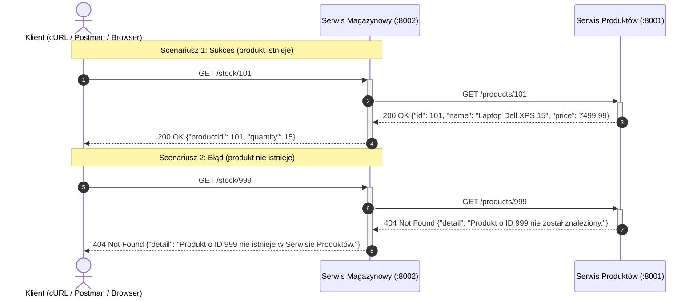

# System Rozproszony z użyciem REST API

Projekt demonstracyjny przedstawiający implementację systemu rozproszonego opartego na architekturze mikroserwisowej z wykorzystaniem **REST API** przez protokół HTTP.

System składa się z dwóch niezależnych mikroserwisów, które współpracują w celu realizacji procesu biznesowego sprawdzania dostępności magazynowej towarów.

---

## 🏗️ Architektura Systemu

System realizuje proces synchronicznej komunikacji międzyserwisowej (*inter-service communication*):



---

## 📋 Kontrakt API

### 1. Serwis Produktów (Port `8001`)
Zarządza katalogiem produktów (dane w pamięci RAM).

| Metoda | Endpoint | Opis | Kody statusu |
|---|---|---|---|
| `GET` | `/products/{id}` | Pobiera szczegóły produktu o podanym ID | `200 OK`, `404 Not Found` |
| `GET` | `/products` | Zwraca listę wszystkich produktów | `200 OK` |
| `GET` | `/docs` | Interaktywna dokumentacja Swagger UI | `200 OK` |

**Przykładowa odpowiedź (`200 OK`):**
```json
{
  "id": 101,
  "name": "Laptop Dell XPS 15",
  "price": 7499.99
}
```

**Odpowiedź w przypadku błędu (`404 Not Found`):**
```json
{
  "detail": "Produkt o ID 999 nie został znaleziony."
}
```

---

### 2. Serwis Magazynowy (Port `8002`)
Odpowiada za stan magazynowy produktów. Kluczowym zadaniem jest wykonanie zapytania HTTP do Serwisu Produktów w celu weryfikacji istnienia towaru.

| Metoda | Endpoint | Opis | Kody statusu |
|---|---|---|---|
| `GET` | `/stock/{productId}` | Sprawdza produkt w Serwisie Produktów i zwraca stan | `200 OK`, `404 Not Found`, `503 Service Unavailable` |
| `GET` | `/docs` | Interaktywna dokumentacja Swagger UI | `200 OK` |

**Przykładowa odpowiedź (`200 OK`):**
```json
{
  "productId": 101,
  "quantity": 15
}
```

**Odpowiedź w przypadku braku produktu (`404 Not Found` - błąd propagowany):**
```json
{
  "detail": "Produkt o ID 999 nie istnieje w Serwisie Produktów."
}
```

---

## 📁 Struktura Projektu

```text
restapi/
├── product_service/
│   ├── __init__.py
│   └── main.py                     # Implementacja Serwisu Produktów (FastAPI, port 8001)
├── stock_service/
│   ├── __init__.py
│   └── main.py                     # Implementacja Serwisu Magazynowego (FastAPI, port 8002)
├── screenshots/
│   ├── 01_running_servers.png      # Screenshot uruchomionych obu mikroserwisów
│   ├── 02_success_scenario.png     # Screenshot scenariusza sukcesu (200 OK)
│   └── 03_error_scenario.png       # Screenshot scenariusza błędu (404 Not Found)
├── test_system.py                  # Skrypt automatycznych testów integracyjnych
├── run_servers.py                  # Uruchamianie obu serwisów w jednym skrypcie
├── start_all.bat                   # Uruchomienie obu serwisów w osobnych oknach cmd
├── generate_assets.py              # Generator zrzutów ekranu do dokumentacji
├── generate_pdf_report.py          # Generator sprawozdania PDF
├── Sprawozdanie_System_Rozproszony_REST_API.pdf # Gotowy raport do oddania zadania
├── requirements.txt                # Zależności Python (FastAPI, uvicorn, requests)
└── README.md
```

---

## 🚀 Uruchomienie i Testowanie

### Wymagania
* Python 3.9+
* Zainstalowane pakiety z `requirements.txt`:
  ```bash
  pip install -r requirements.txt
  ```

### Uruchomienie mikroserwisów

#### Opcja A (Automatyczna - Windows):
Uruchom plik `start_all.bat` klikając dwukrotnie lub z poziomu terminala:
```powershell
.\start_all.bat
```

#### Opcja B (Ręczna w osobnych terminalach):
**Terminal 1 (Serwis Produktów):**
```powershell
python product_service/main.py
```

**Terminal 2 (Serwis Magazynowy):**
```powershell
python stock_service/main.py
```

---

## 🧪 Testowanie API

### 1. Automatyczne testy integracyjne
Gdy oba serwery są uruchomione, uruchom w trzecim oknie:
```powershell
python test_system.py
```

### 2. Ręczne testy (cURL)

**Scenariusz Sukcesu (produkt istnieje):**
```bash
curl -i http://localhost:8002/stock/101
```
*Zwraca status `200 OK` i stan magazynowy produktu `101`.*

**Scenariusz Błędu (produkt nie istnieje):**
```bash
curl -i http://localhost:8002/stock/999
```
*Zwraca status `404 Not Found` informujący, że produkt nie istnieje w Serwisie Produktów.*


